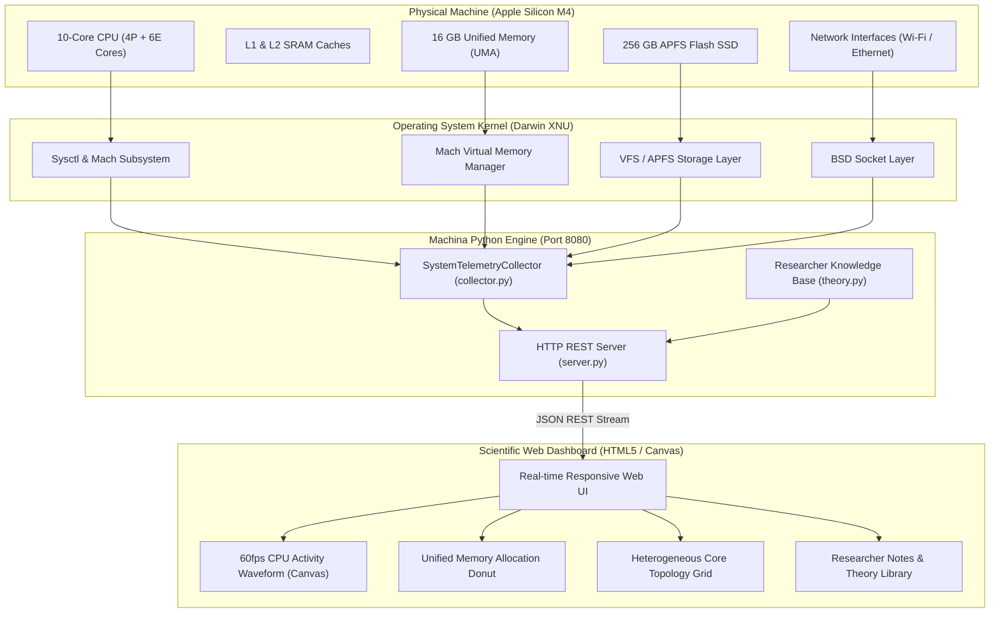

# Machina Telemetry Lab 🔬💻
**Computer Architecture Diagnostics & Real-Time Telemetry Research Station**

A lightweight, researcher-oriented web application and telemetry engine designed to provide deep graphical representations and clear scientific explanations of your computer's internal architecture, hardware subsystems, and real-time execution dynamics.

---

## 🏛️ System Architecture Overview



---

## ✨ Features & Capabilities

1. **Heterogeneous Multi-Processing (HMP) Core Matrix**:
   - Maps out all 10 physical cores of the Apple M4 chip.
   - Highlights the split between **4 Performance (P) Cores** (high frequency, 8-wide decode) and **6 Efficiency (E) Cores** (low power, background scheduling).
2. **Mach Virtual Memory & Unified RAM Breakdown**:
   - Visualizes memory distribution across **Wired**, **Active**, **Inactive**, **Compressed in RAM**, and **Free** pages.
   - Live memory pressure heuristics and zero-thrashing swapout monitoring.
3. **Interactive Cache Latency Pyramid**:
   - Displays real-world access latencies and light-travel distances:
     - L1 Cache: ~1.0 ns (30 cm)
     - L2 Cache: ~3.5 ns (1 m)
     - Unified RAM: ~70 ns (20 m)
     - NVMe Flash: ~25,000 ns (7.5 km)
4. **Real-Time Canvas Waveforms**:
   - Rolling 30-second multi-trace CPU activity graph (User % vs System % vs Idle %).
   - Rolling auto-scaling network throughput graph (Inbound vs Outbound KB/s).
5. **Storage & Disk Dynamics**:
   - APFS root partition capacity tracking and real-time disk transfer rates (MB/s and tps).
6. **Built-in Researcher Notes Mode**:
   - Provides clear, simple analogies alongside rigorous computer engineering explanations for concepts like the Von Neumann Memory Wall, queueing theory behind Load Averages, and copy-on-write filesystems.
7. **Zero Third-Party Dependencies & Zero Permissions Needed**:
   - Built entirely with Python 3 standard library (`http.server`, `socketserver`, `subprocess`).
   - Requires NO `pip install`, NO root permissions (`sudo`), and NO internet access to run.

---

## 🚀 Quick Start Guide

### Option 1: Launch Web Dashboard (Recommended)

From the project root:

```bash
./run.sh
```

Or using standard Python:

```bash
python3 backend/server.py
```

Then open your browser at: **`http://localhost:8080`**

### Option 2: Terminal ASCII Dashboard (CLI Mode)

If you prefer viewing live telemetry inside your terminal:

```bash
python3 cli_dashboard.py
```

---

## 📡 REST API Reference

The built-in web server exposes clean JSON endpoints for integration or programmatic research:

| Endpoint | Method | Description |
| :--- | :--- | :--- |
| `/api/specs` | `GET` | Static machine specifications (Chip, cores, cache sizes, kernel, memory capacity) |
| `/api/telemetry` | `GET` | Real-time dynamic snapshot (CPU, memory breakdown, disk I/O, network bandwidth, uptime) |
| `/api/theory` | `GET` | Educational researcher knowledge base and theoretical models |
| `/api/snapshot` | `GET` | Consolidated experimental report bundle for export and data logging |

---

## 📂 Project Structure & SCSS Architecture

```
system_telemetry_lab/
├── README.md              # Project documentation & architectural guide
├── package.json           # SCSS build scripts & tooling configuration
├── run.sh                 # One-click launcher script
├── cli_dashboard.py       # Terminal ANSI color visualizer
├── backend/
│   ├── collector.py       # High-precision system telemetry extractor
│   ├── theory.py          # Academic models & researcher notes library
│   └── server.py          # Lightweight HTTP server & JSON REST API
├── frontend/
│   ├── index.html         # Scientific dashboard interface
│   ├── style.css          # Compiled production stylesheet
│   ├── app.js             # 60fps Canvas charting engine & telemetry client
│   └── scss/              # 🎨 Modular SCSS Architecture (High Reusability)
│       ├── main.scss      # Master stylesheet entrypoint
│       ├── _variables.scss# Design tokens: palette, typography, spacing, breakpoints
│       ├── _mixins.scss   # Reusable mixins: glass-card, flexbox, badges, transitions
│       ├── _components.scss# Reusable UI components: meters, buttons, core cards, pyramid
│       └── _layout.scss   # 12-column responsive grid, header, panels, footer
└── docs/                  # GitHub Pages distribution (with identical scss/ and assets)
```

### 🎨 Reusable SCSS System

The styling is refactored into a **modular, tokenized SCSS design system**:
* **`_variables.scss`**: Centralized design tokens for colors (deep obsidian, neon cyan, emerald, purple, amber), typography, border radiuses, and responsive breakpoints.
* **`_mixins.scss`**: Reusable mixins including `@mixin glass-card()`, `@mixin flex-between`, `@mixin hover-elevation()`, `@mixin badge()`, and `@mixin respond-to()`.
* **`_components.scss`**: Decoupled, reusable components (KPI cards, meter bars, core diagnostics chips, latency pyramid tiers, and expandable researcher cards).
* **`_layout.scss`**: Responsive 12-column grid and flex layouts.
